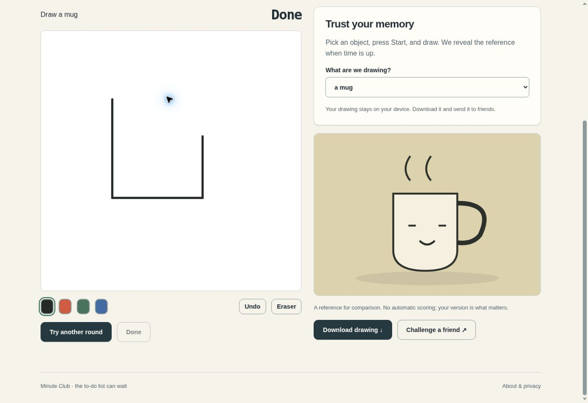

<div align="center">


# Memory Sketch

**Thirty seconds. No peeking.**

Draw an everyday object from memory, reveal the reference, and save your version.

**English** · [Русский](README.ru.md)

  

</div>

[Features](#features) · [Stack](#technology-stack) · [Quick start](#quick-start) · [License](LICENSE)



*Actual application capture with example data. Visible counts are demonstration interactions, not audience statistics.*

## Features

- Fourteen reference objects and a 30-second timer
- Pen colors, eraser, and undo
- Local PNG export and shareable object challenges

**Try the flow: Choose → sketch → reveal → save.**

Documentation: English / Русский. App interface: English, Русский, selected from browser preferences or manually. System theme by default, with explicit light and dark modes. The system mode follows device changes; your choice is saved locally.

## Technology stack

| Layer | Implementation |
| --- | --- |
| Interface | HTML · CSS · JavaScript / native ES modules |
| Runtime | Browser only |
| Development | TypeScript for preferences; the rest is JavaScript |
| Dependencies | No third-party browser libraries or remote fonts |

## Quick start

Serve `public/` with any static HTTP server at a domain root. For a local preview, for example:

```sh
python3 -m http.server 8080 --directory public
```

Open http://localhost:8080. Opening the HTML via `file://` is unsupported because native ES modules need HTTP. No Node.js server, database, API key, or build is needed in production.

## Checks

With Node.js 24+: `npm test` and `npm run check`.

## Deployment and data

Upload the contents of `public/` to your static host. Absolute asset paths assume a domain root; a GitHub Pages project subpath requires adapting paths or using a custom domain. Drawings and preferences stay on the device. Clearing site data removes drafts. Exported PNG files are created locally.

Fourteen reference objects, a 30-second timer, pen colors, eraser, undo, PNG export, and shareable object challenges. Automatic recognition is not used. The canvas supports mouse and touch; drawing itself requires a pointing device.

## Develop with TypeScript

Generated JavaScript is committed, so production needs no TypeScript compiler. Development uses pinned tools:

```sh
npm ci
npm run typecheck
npm run build
npm run check:generated
npm test
npm run check
```

`src/preferences*.ts` is the source for language negotiation and the early theme bootstrap. `src/contracts.ts` describes shared data shapes. The compiler uses strict mode, checked indexed access, and exact optional properties; errors block emission. Edit these TypeScript sources, then rebuild. Other existing application modules are still JavaScript: this is an incremental migration, not a claim of complete TypeScript coverage.

The build emits ordinary ES2022 JavaScript, then compiles the two locale variants. No compiler or framework is shipped to visitors. CI checks types, generated output, behavior, and the asset budget.

---

[More by den9911](https://github.com/den9911) · [Report an issue](https://github.com/den9911/memory-sketch/issues) · [LICENSE](LICENSE)
